# Quizzes for IB Y2 

## Quiz 1 - 13/08/2026

### Prompt: 
Create a class that generates a random number between 0 and 256, returns a string.

### Code Solution: 
```java
public class RanNum {
    public String getNumber() {
        int num = (int) (Math.random() * 257);
        return num + "";
    }
```

### Screenshot Proof:
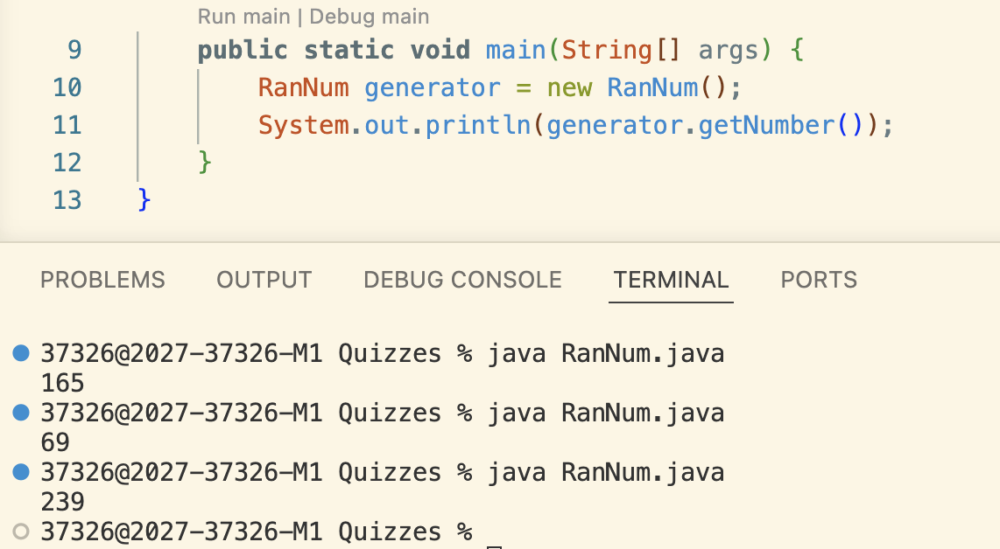


## Quiz 2 - 18/08/2026

### Prompt: 
Create a class that generates a valid IPv4 address. You may use the class RanNum()

### Code Solution:
```java
public class IPv4 {
    public String generate() {
        String string = "#";
        for (int i = 0 ; i < 4; i++) {
            RanNum num = new RanNum();
            if (i == 3) {
                string = string + num.getNumber();
            } else {
                string = string + num.getNumber() + ".";
            }  
        }
        return string;
    }
```

### Screenshot Proof:
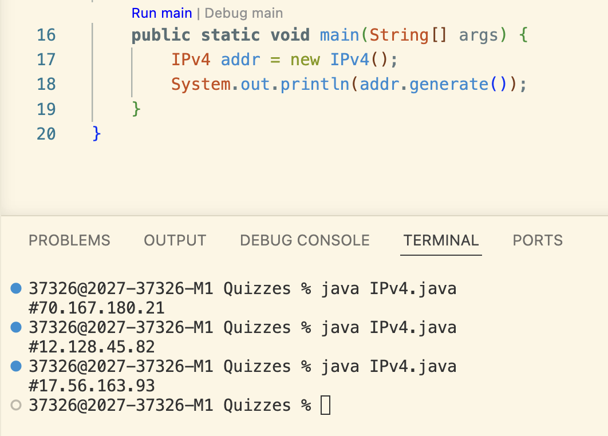


## Quiz 3 - 20/08/2026

### Prompt: 
Create a class that receives a input String add and it checks for valid IPv4 address.

### Code Solution:
```java
public class Checker {
    private boolean test = true;
    public Checker(String add) {
        String[] pieces = add.split("\\.");

        if (pieces.length != 4) {
            test = false;
        } else {
            for (int i = 0; i < pieces.length; i++) {
                try {
                    int num = Integer.parseInt(pieces[i]);
                    if (num < 0 || num > 255) {
                        test = false;
                    }
                } catch(Exception NumberFormatException) {
                    test = false;
                }
            }
        }
    }
```
### Screenshot Proof:  
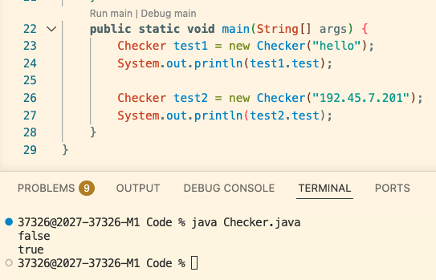


## Quiz 4 - 21/08/2026

### Prompt:
Create a class receives a service name, ip address and build a ip:port address.

### Code Solution:
```java
public class Porter {
    private ArrayList<String> service = new ArrayList<>();
    private ArrayList<String> port = new ArrayList<>();
    private String serviceName;
    private String ip;
    private String portNum;

    public Porter(String serviceName, String ip) {
        this.serviceName = serviceName;
        this.ip = ip;
        service.add("http"); service.add("https"); service.add("playstation"); service.add("ssh"); service.add("ftp"); service.add("mysql");
        port.add("80"); port.add("443"); port.add("3479"); port.add("22"); port.add("20"); port.add("3306");
    }

    public String build() {
        for (int i = 0; i < service.size(); i++) {
            if (serviceName.equals(service.get(i))) {
                portNum = port.get(i);
                break;
            } else {
                portNum = "-1";
            }
        }
        
        if (portNum.equals("-1")) {
            return "#service not on record table. Use register() to add a new service:port pair";
        } else {
            return "#" + ip + ":" + portNum;
        }
    }

    public void register(String service, String port) {
        this.service.add(service);
        this.port.add(port);
    }
}
```

### Screenshot Proof:
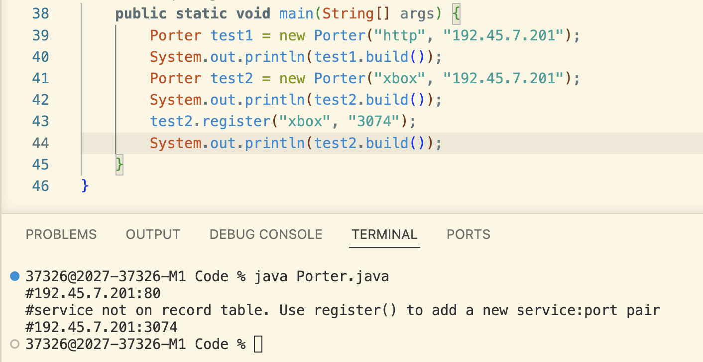


## Quiz 5 - 24/08/2026

### Prompt:
Create a class that uses parallel arrays to store a table of hostnames and their IP addresses.

### Code Solution:
```java
import java.util.ArrayList;
public class DNS {
    private ArrayList<String> hostName = new ArrayList<>();
    private ArrayList<String> IP = new ArrayList<>();
    private String host;
    private String ip;

    public DNS(String host) {
        this.host = host;
        this.hostName.add("localhost"); this.hostName.add("google.com"); this.hostName.add("example.com");
        IP.add("127.0.0.1"); IP.add("142.250.72.14"); IP.add("7.7.7.7");
    }

    public String lookup() {
        for (int i = 0; i < hostName.size(); i++) {
            if (host.equals(hostName.get(i))) {
                ip = IP.get(i);
                break;
            } else {
                ip = "-1";
            }
        }
        
        if (ip.equals("-1")) {
            return "#hostname not on record table. Use register() to add a new hostname:IP pair";
        } else {
            return "#" + ip;
        }
    }

    public void register(String host, String ip) {
        hostName.add(host);
        IP.add(ip);
    }
}
```

### Screenshot Proof:
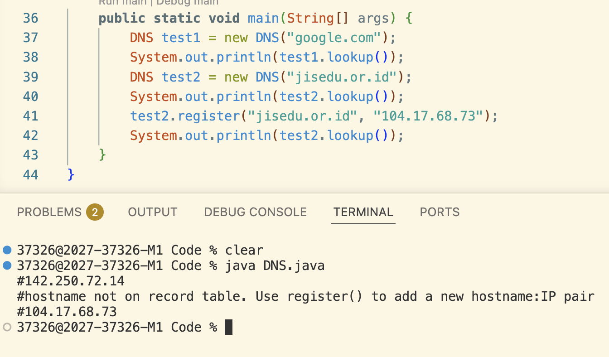


## Quiz 6 - 27/08/2026

### Prompt:
Create a class that uses parallel arrays to filter traffic in network using ip/hostnames, assume the DNS:

### Code Solution:
```java
public class Filter {
    private String[] hostName = {"localhost", "google.com", "example.com"};
    private String[] ip = {"127.0.0.1", "142.250.72.14", "7.7.7.7"};
    private String test;

    public Filter (String test) {
        this.test = test;
    }

    public String check() {
        for (int i = 0; i < hostName.length; i++) {
            if (test.equals(hostName[i])) {
                return "#accepted with ip:" + ip[i] + " hostname:" + test;
            } 
            if (test.equals(ip[i])) {
                return "#accepted ip:" + test + " hostname:" + hostName[i];
            }
        }
        return "#rejected";
    }
}
```

### Screenshot Proof:
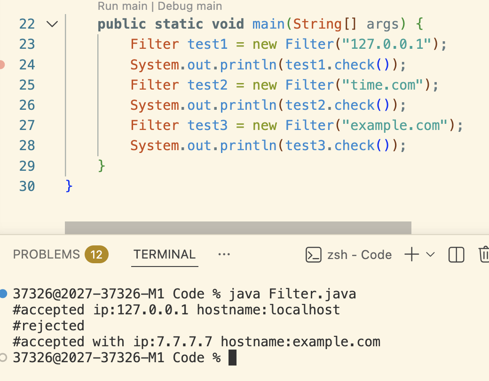


## Quiz 7 - 31/08/2026

### Prompt:
Create the flow diagram for the method below:
```java
public String generateMAC() {
    Random r = new Random();
    String[] hex = {"0","1","2","3","4","5","6","7","8","9","A","B","C","D","E","F"};
    String mac = "";

    for (int i = 0; i < 6; i++) {
        int number = r.nextInt(256);
        int first = number / 16;
        int second = number % 16;
        mac += hex[first] + hex[second];
        if (i < 5) {
            mac += ":";
        }
    }
    return mac;}
```

### Screenshot Proof:
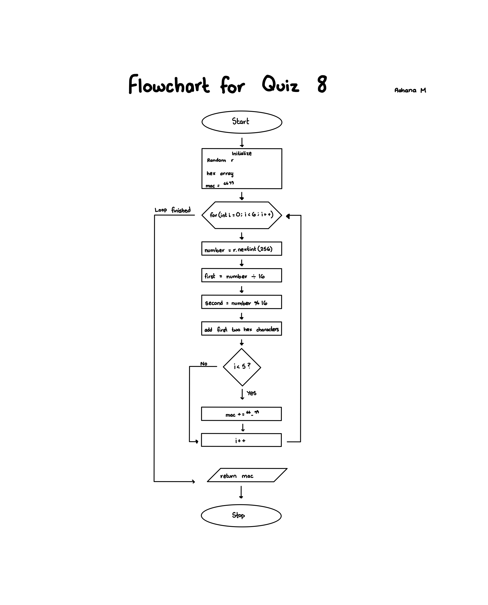


## Quiz 8 - 02/09/26

### Prompt:
Create a class that uses parallel arrays to store a NAT table (Network Address Translation)

### Code Solution:
```java
public class NAT {
    private int deviceCount = 0;
    private String[] localIP;
    private int[] localPorts;
    private int[] publicPorts;
    private String publicIP;

    public NAT (String publicIP, int deviceCount) {
        this.publicIP = publicIP;
        localIP = new String[deviceCount];
        localPorts = new int[deviceCount];
        publicPorts = new int[deviceCount];
    }

    public String get_new_trans(String ip, int port) {
        localIP[deviceCount] = ip;
        localPorts[deviceCount] = port;
        publicPorts[deviceCount] = 10001 + deviceCount;
        deviceCount++;

        return publicIP + ":" + publicPorts[deviceCount - 1];
    }
}
```

### Screenshot Proof:
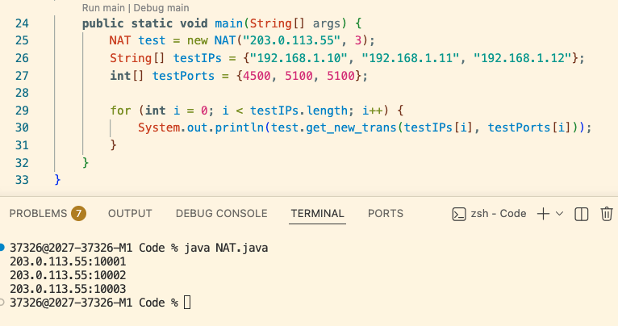


## Quiz 9 - 04/09/26

### Prompt:
Create a class that receives a 2D array and returns the average across columns and across rows.

### Code Solution:
```java
public class Average {
    int rows;
    int cols;
    int[] avgRows;
    int[] avgCols;

    public Average (int[][] nums) {
        rows = nums.length;
        cols = nums[0].length;

        avgRows = new int[rows];
        for (int i = 0; i < rows; i++) {
            int sum = 0;
            for (int z = 0; z < cols; z++) {
                sum+= nums[i][z];
            }
            avgRows[i] = sum / rows;
        }

        avgCols = new int[cols];
        for (int i = 0; i < rows; i++) {
            int sum = 0;
            for (int z = 0; z < cols; z++) {
                sum += nums[z][i];
            }
            avgCols[i] = sum / cols;
        }
    }

    public String avgCols() {
        return Arrays.toString(avgCols);
    }

    public String avgRows() {
        return Arrays.toString(avgRows);
    }
}
```

### Screenshot Proof:
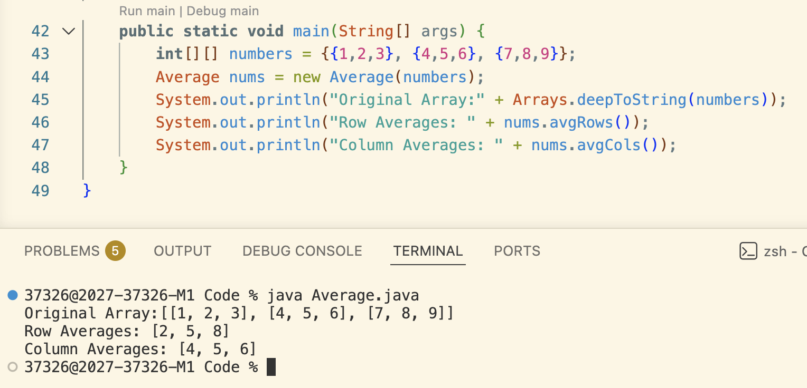

## Quiz 10 - 07/09/26

### Prompt:
Create a class that receives a 2D array and a integer, returns the array scaled by the constant:

### Code Solution:
```java

import java.util.Arrays;

public class Matrix {
    private int[][] matrix;

    public Matrix (int[][] matrix) {
        this.matrix = matrix;
    }

    public int[][] scale (int scale) {
        int size = matrix[0].length;
        for (int x = 0; x < size; x++) {
            for (int y = 0; y < size; y++) {
                matrix[x][y] *= 3;
            }
        }
        return matrix;
    }

    public String show(int[][] x) {
        String string = "";
        for (int r = 0; r < x.length; r++) {
            string += Arrays.toString(x[r]) + "\n";
        }
        return string;
    }
}
```

### Screenshot Proof:


## Quiz 11 - 08/09/26

### Prompt:
Create a class that receives a constant n and returns a identity matrix of size n x n

### Code Solution:
```java
public int[][] identity() {
    int size = matrix.length;
    int[][] identity = new int[size][size];
    for (int i = 0; i < size; i++) {
        for (int j = 0; j < size; j++) {
            if (i == j) {
                identity[i][j] = 1;
            } else {
                identity[i][j] = 0;
            }
        }
    }
    return identity;
}
```

### Screenshot Proof:
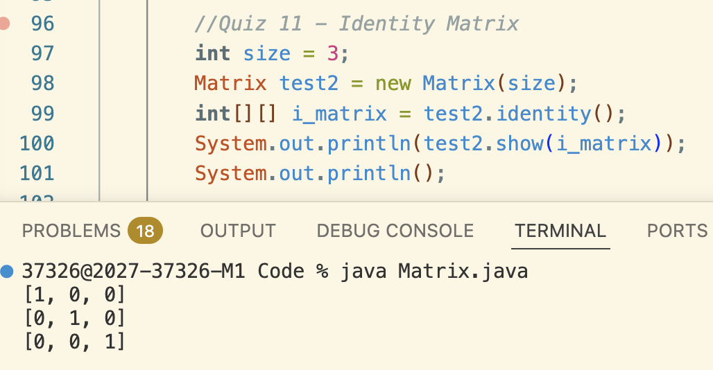


## Quiz 12 - 10/09/26

### Prompt:
Create a method that receives a matrix of size n x m: the output is a 1D “vectorized” version of the input.

### Code Solution:
``` java
public int[] vectorize() {
    int n = matrix.length;
    int m = matrix[0].length;
    int k = 0;
    int[] vectorized = new int[n * m];
    for (int r = 0; r < n; r++) {
        for (int c = 0; c < m; c++) {
            vectorized[k] = matrix[r][c];
            k++;
        }
    }
    return vectorized;

    public String show(int[] x) {
        return Arrays.toString(x);
    }
}
```

### Screenshot Proof:


## Quiz 13 - 14/09/26

### Prompt:
Create a method that receives a 1D array and builds a square matrix, use zero-padded.

### Code Solution:
``` java
public int[][] toMatrix() {
    int s = (int) Math.sqrt(array.length);
    if (s*s != array.length) {
        s++;
    }
    int[][] square = new int[s][s];
    for (int i = 0; i < array.length ; i++) {
        square[i/s][i%s] = array[i];
    }
    return square;
}
```

### Screenshot Proof:


## Quiz 10-14

### Final Matrix.java Code
``` java

import java.util.Arrays;

public class Matrix {
	private int[][] matrix;
	private int[] array;

	public Matrix (int[][] matrix) {
		this.matrix = matrix;
	}

	public Matrix (int[] array) {
		this.array = array;
	}

	public Matrix(int size) {
		matrix = new int[size][size];
	}

	public int[] vectorize() {
		int n = matrix.length;
		int m = matrix[0].length;
		int k = 0;
		int[] vectorized = new int[n * m];
		for (int r = 0; r < n; r++) {
			for (int c = 0; c < m; c++) {
				vectorized[k] = matrix[r][c];
				k++;
			}
		}
		return vectorized;
	}

	public int[][] scale (int scale) {
		int size = matrix[0].length;
		for (int x = 0; x < size; x++) {
			for (int y = 0; y < size; y++) {
				matrix[x][y] *= 3;
			}
		}
		return matrix;
	}

	public int[][] identity() {
		int size = matrix.length;
		int[][] identity = new int[size][size];
		for (int i = 0; i < size; i++) {
			for (int j = 0; j < size; j++) {
				if (i == j) {
					identity[i][j] = 1;
				} else {
					identity[i][j] = 0;
				}
			}
		}
		return identity;
	}

	public int[][] toMatrix() {
		int s = (int) Math.sqrt(array.length);
		if (s*s != array.length) {
			s++;
		}
		int[][] square = new int[s][s];
		for (int i = 0; i < array.length ; i++) {
			square[i/s][i%s] = array[i];
		}
		return square;
	}

	public int[][] diagonal(int size) {
		int[][] diagonal = new int[size][size];
		int k = 1;
		for (int i = 0; i < size; i++) {
			for (int j = 0; j < size; j++) {
				if (i == j) {
					diagonal[i][j] = k;
					k++;
				} else {
					diagonal[i][j] = 0;
				}
			}
		}
		return diagonal;
	}

	public String show(int[] x) {
		return Arrays.toString(x);
	}

	public String show(int[][] x) {
		String string = "";
		for (int r = 0; r < x.length; r++) {
			string += Arrays.toString(x[r]) + "\n";
		}
		return string;
	}

	public static void main(String[] args) {
		//Quiz 10 - Scaled Matrix:
		int[][] matrix = {
				{1, 2, 3},
				{4, 5, 6},
				{7, 8, 9}
		};
		int scale = 3;
		Matrix test = new Matrix(matrix);
		int[][] scaled_matrix = test.scale(scale);
		System.out.println(test.show(scaled_matrix));
		

		//Quiz 11 - Identity Matrix
		int size = 3;
		Matrix test2 = new Matrix(size);
		int[][] i_matrix = test2.identity();
		System.out.println(test2.show(i_matrix));
		System.out.println();
		
		
		//Quiz 12 - Vectorized Matrix:
		int[][] numbers = { {1, 2, 3, 3}, {4, 5, 6, 6}, {7, 8, 9, 9} };
		Matrix test3 = new Matrix(numbers);
		int[] vectorized_matrix = test3.vectorize();
		System.out.println(test3.show(vectorized_matrix));
		System.out.println();
		

		//Quiz 13 - Square Matrix:
		int[] numbers2 = {1, 2, 3, 3, 4, 5, 6, 6, 7, 8 };
		Matrix test4 = new Matrix(numbers2);
		int[][] into_matrix = test4.toMatrix();
		System.out.println(test4.show(into_matrix));

		//Quiz 14 -  Diagonal Matrix:
		size = 4;
		Matrix test5 = new Matrix(size);
		into_matrix = test5.diagonal(size);
		System.out.println(test5.show(into_matrix));
	}
}
```


## Quiz 14 - 13/10/26

### Prompt:
Create a method that creates a ascending diagonal matrix

### Code Solution:
```java
public int[][] diagonal(int size) {
	int[][] diagonal = new int[size][size];
	int k = 1;
	for (int i = 0; i < size; i++) {
		for (int j = 0; j < size; j++) {
			if (i == j) {
				diagonal[i][j] = k;
				k++;
			} else {
				diagonal[i][j] = 0;
			}
		}
	}
	return diagonal;
}
```

### Screenshot Proof:
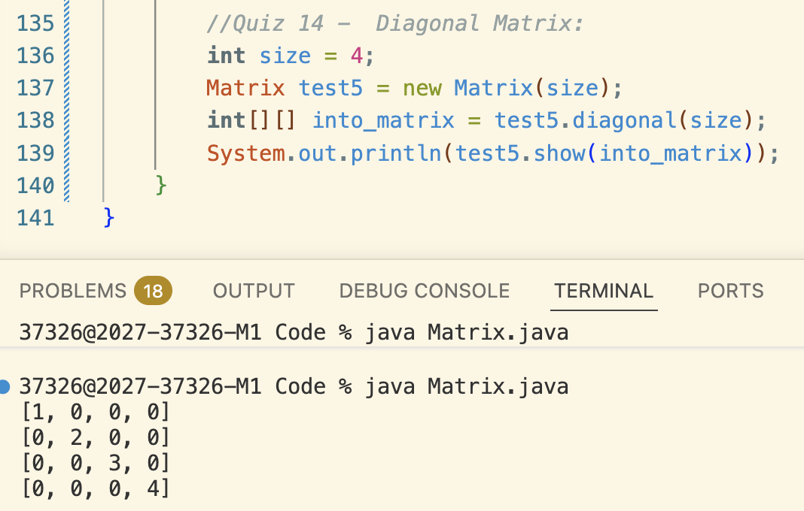


## Quiz 15 - 14/10/26

### Prompt:
Create a method that calculates the error in representation of a ADC with a range 0-5v and resolution 6 bits for and voltage measured from an analog input.

### Code Solution:
```java
static double calculateADCError(double sample) {
    double resolution = 5.0/Math.pow(2, 6);
    int digitalValue = (int) (sample/resolution);
    double represented = digitalValue * resolution;
        
    return Math.abs(sample - represented);
}
```

### Screenshot Proof:
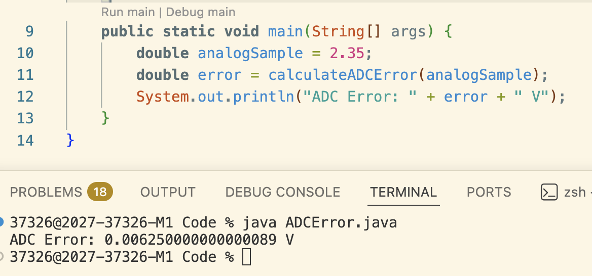


## Quiz 16 - 15/10/26

### Prompt:
Create a method that calculates the minimum number of bits required for an ADC to measure the smallest voltage difference specified in an array of voltage values, given the minimum and maximum input voltage range.

### Code Solution:
```java
static int calculateResolution(double min, double max, double[] readings) {
    double smallestDifference = Double.MAX_VALUE;
    for (int i = 0; i < readings.length; i++) {
        for (int j = i + 1; j < readings.length; j++) {
            double difference = Math.abs(readings[i] - readings[j]);
            if (difference > 0 && difference < smallestDifference) {
                smallestDifference = difference;
            }
        }
    }
    double voltageRange = max - min;
    int bits = (int) Math.ceil(Math.log(voltageRange / smallestDifference) / Math.log(2));
    
    return bits;
}
```

### Screenshot Proof:
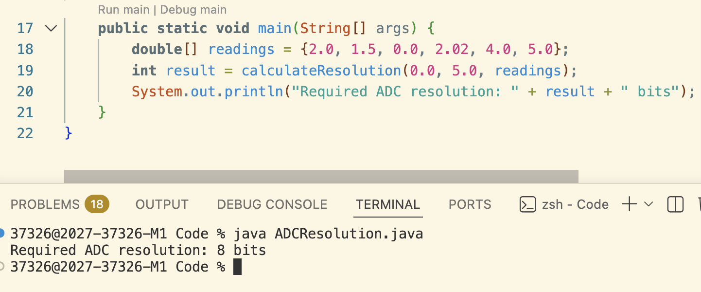


## Quiz 17 - 21/10/26

### Prompt:
Define the term encapsulation in the context of computer networks: 							[2]

### Answer:
Encapsulation is the concept of having all related attributes/behaviours in a single unit. For example, an assignment class would hold all the vairables and methods relaed to assignments (title, subject, etc) as one singular class. In networks, this could look like data packets containing all relevant data for transfering information in a singular packet (eg. IP address, MAC address, sequences number, etc).


## Quiz 18 - 23/10/26

### Prompt:
State the fundamental technologies required for a VPN service									[2]

### Answer:
VPNS require some encryption technology. It is used to mask the network activity of the user by encrypting their traffic such as ISPs cannot see exactly what they're doing and what websites they access. VPNs also require tunneling. This is to alter the IP of the user to a different geographical location to circumvent regional blocks.


## Quiz 19 - 27/10/26

### Prompt:
Identify one protocol used in the Application layer of the TCP/IP model.						[2]

### Answer:
One protocol used is Hypertext Transfer Protocol Secure (HTTPS). This is the secure protocol for websites.


## Quiz 20 - 29/10/26

### Prompt:
Outline one step needed during preprocessing of a numerical database	 [2]

### Answer:
Data inspection. This is when the data is observed to figure out how it is organized, what it contains, types of data (String, double, boolean, etc), and more. This is needed in order to understand exactly what is being processed, its domains, etc.


## Quiz 21 - 30/10/26

### Prompt: 
A marketing firm uses ML to analyze customer survey data.  Describe one common issue in survey data that would require data  preprocessing.         [4]

### Answer:
One common issue faced in survey data is recieving data in the wrong type. For example, when rating a marketing strategy from 1-10, survey-takers may respond in various ways such as: "10", "ten", "10.0", and etc. This leads to type errors due to the user manually inputing values and would require preprocessing to normalize all the various types of responses into one, single type. This requires lots of time and resources to go through all the data and process it.


## Quiz 22 - 02/11/26

### Prompt: 
A school is developing a ML model to predict students' performance based on data from previous academic years. Explain how data preprocessing can improve the outcomes of the ML model.         [6]

### Answer:
Data preprocessing will allow the school to normalize/standardize the dtaa prior to any calculations in order to prevent any errors. For example, a student may input a grade in many different ways, eg. "5", "five", "5.0", "pass" which leads to an type error. OR a student may input an impossible grade eg. "-5%" or "110%" which can lead to the ML model being inaccurate or provide impossible predictions. Data preprocessing will allow the school to identify these errors through data validation, data type validation, data cleaning, and etc to address these errors and keep the model accurate.


## Quiz 23 - 04/11/26

### Prompt:
A university is preparing an ML model for admission purposes using a dataset containing 50 different metrics from applicants. Explain how dimensionality reduction techniques could be used in this context. [6]

### Answer:


## Quiz 24 - 09/11/26

### Prompt:
Explain why k-fold cross validation is used with the k-nn technique. [3]

### Answer:
k-fold cross validation is used to address and avoid overfitting This is done by selecting how many iterations of splitting the database into training and testing sections we want, called folds, and then process the data multiple times while changing the folds to find the result from a variety of divisions in the database rather than just one lucky division.